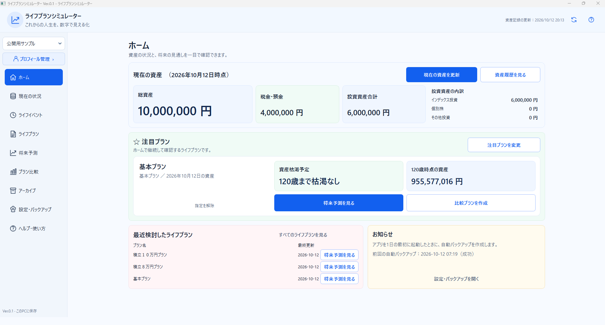
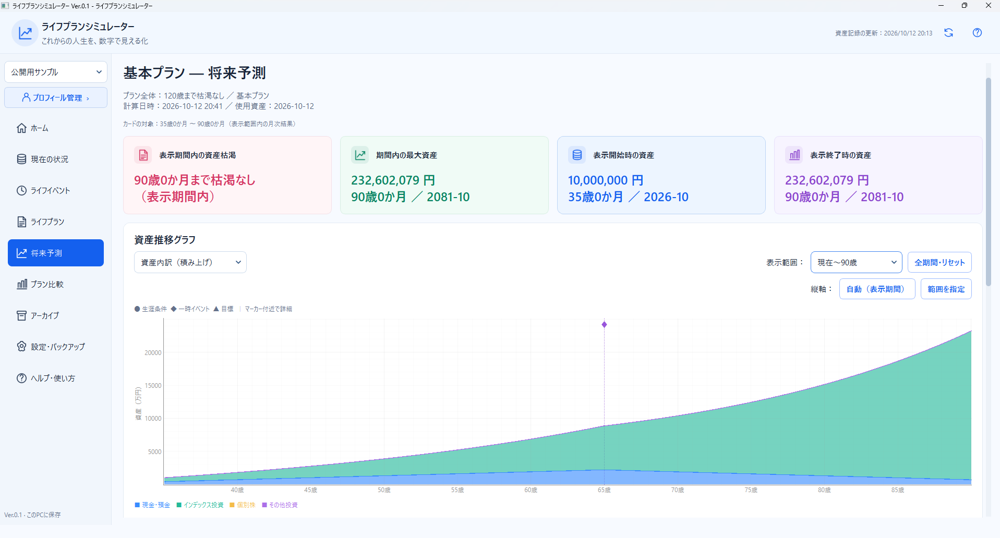
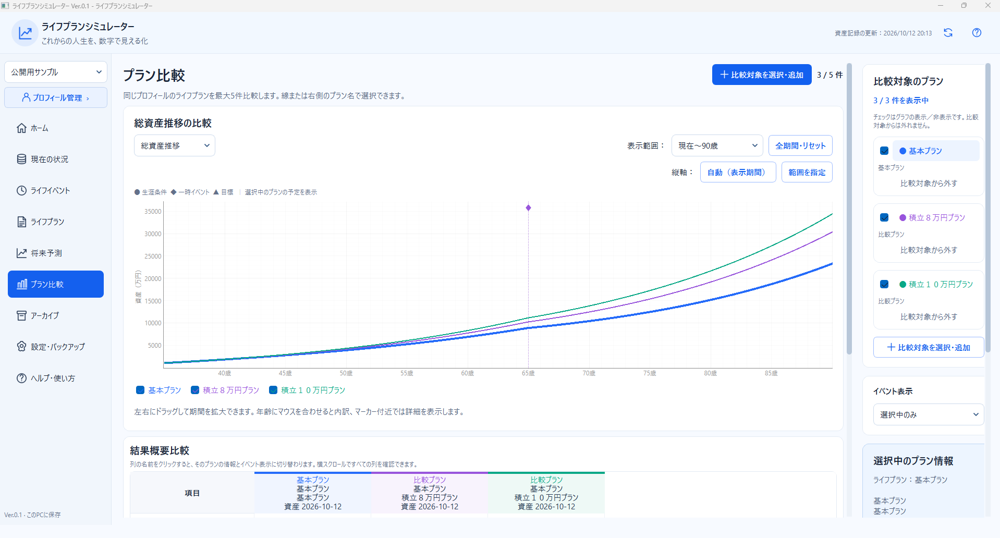

# ライフプランシミュレーター

**これからの人生を、数字で見える化。**

ライフプランシミュレーターは、現在の資産、収入、生活費、積立投資、退職や年金などのライフイベントをもとに、将来の資産推移をシミュレーションできるWindows向け無料アプリです。

複数のライフプランを比較しながら、「積立額を変えると将来資産はどうなるか」「今の生活費で資産は何歳まで持つか」といった疑問を検討できます。

**Ver.0.1は試験公開版です。** ご利用中に不具合や分かりにくい点が見つかる可能性があります。

## 主な機能

- **資産管理**：現金・預金、インデックス投資、個別株などの資産を記録
- **将来予測**：収入・支出・積立額・想定利回りをもとに、将来の資産推移を計算
- **ライフイベント**：退職、年金受給開始、収入や積立額の変更などをプランに反映
- **プラン比較**：複数の条件を同じグラフで比較
- **資産の内訳表示**：現金・預金と投資資産の推移をグラフで確認
- **バックアップ・復元**：データのバックアップと復元に対応

## スクリーンショット

※掲載画像はすべて架空のサンプルデータを使用しています。

### ホーム画面

現在の資産と、注目しているライフプランの将来予測を確認できます。

### 将来予測

現金・預金と投資資産の内訳を、年齢に沿って確認できます。

### プラン比較

基本プラン（月5万円の積立）と、積立額を月8万円・月10万円に変更したプランを比較した例です。

## ダウンロード・起動方法

Ver.0.1のWindows向け配布ZIPは、GitHubの「Releases（リリース）」からダウンロードできるようにする予定です。

公開後は、ZIPファイルを展開し、フォルダー内の `LifePlanSimulator.exe` を起動してください。

インストーラーは不要です。ZIP内のフォルダー構成は変更せず、そのまま展開して使用してください。

詳しい使用方法や注意事項は、配布ZIPに同梱する `README.txt` をご確認ください。

## 対応環境

- Windows 64ビット環境向け
- Windows 11で動作確認
- インターネット接続を必要としないローカルアプリ

## ご利用にあたって

- このアプリは、資産形成やライフプランの検討を補助するためのツールです。
- 将来の資産額や運用成果を保証するものではありません。
- 計算結果は入力条件や想定利回りによって変化します。
- 本アプリは投資助言を目的としたものではありません。
- 大切なデータは定期的にバックアップしてください。

## バージョン

**Ver.0.1 — 試験公開版**

今後、利用者からのご意見や不具合報告を参考に、改善を検討していきます。
